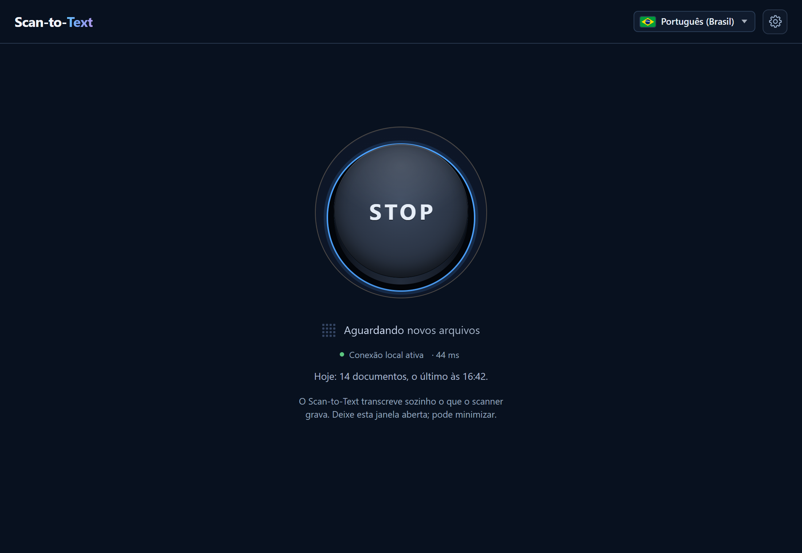
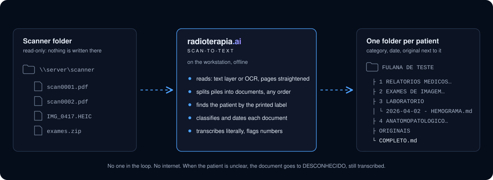
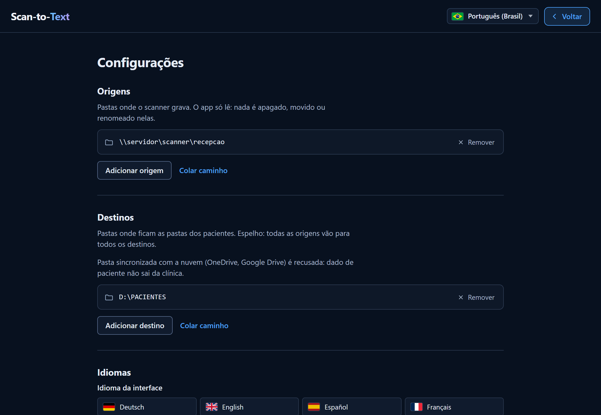
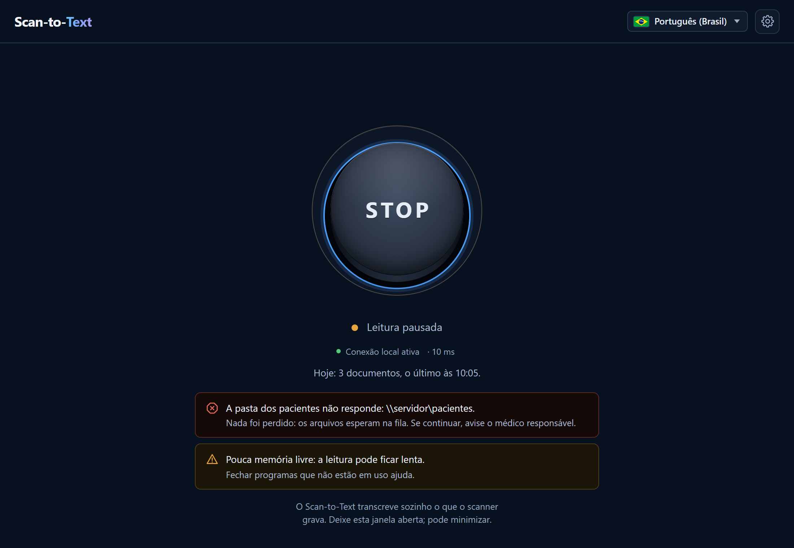

# Scan-to-Text

> **Support tool. Not validated for clinical use.**
> This is not a medical device. It transcribes scanned documents **literally**:
> it does not summarise, does not interpret, does not compute and does not
> diagnose. Optical character recognition makes mistakes, and the dangerous
> ones are plausible numbers. The scanned original, kept next to every
> transcription, is the source of truth. See [NOTICE](NOTICE).

**Private evaluation build.** The clinical pilot is pending. Read the
[release notes](https://github.com/drhenriquebraga/scan-to-text/releases) for
measured coverage and known limitations.

A Windows app that watches the folder where the reception scanner saves its
files and transcribes every document that arrives into Markdown, filed by
patient, category and date. No one has to sit in front of it, and it never
touches the internet.

A **Braga HealthLab** project, published and distributed through
**[radioterapia.ai](https://radioterapia.ai)**, among other channels.

<p align="center">
  
</p>

---

## The problem it solves

Paper reaches a radiotherapy department through the front desk: lab results,
imaging reports, pathology, referral letters, summaries of previous treatments.
It is scanned into a shared folder as `scan0001.pdf`, `scan0002.pdf`… and from
there someone has to open each file, work out whose it is and what it is, and
file it. The physician who later wants to read the patient's history, or hand it
to an AI assistant, needs **text**, not pictures of pages.

Scan-to-Text does the filing and the transcription, unattended:

<p align="center">
  
</p>

1. **Watches** one or more scanner folders. They are **read-only** to the app:
   nothing is ever written, moved or renamed there.
2. **Copies** each new file to the local disk and reads it: the PDF text layer
   when it is good, OCR when it is not. Pages lying sideways or upside down are
   straightened first.
3. **Splits** the file into documents — a pile scanned in one go, pages in any
   order, two patients in the same file, the blank back of a sheet.
4. **Finds the patient** by the printed label (`Paciente:`, `Nome:`…), never
   by a guess, and never confuses the patient with the requesting physician.
   When in doubt the folder is `DESCONHECIDO` (unknown) — but the transcription
   is still delivered.
5. **Classifies** each document into five categories and finds the exam date,
   telling it apart from the date of birth, the print date and the date of the
   previous exam it compares with.
6. **Writes** one Markdown per document, the matching pages of the original
   next to it for checking, and a `COMPLETO.md` with the patient's whole
   history in order.

## What comes out

```
<DESTINATION>\
├─ MARIA DA SILVA - 2026-09-27\
│  ├─ 1 RELATORIOS MEDICOS E ENCAMINHAMENTOS\
│  │   ├─ 2026-05-10 - ENCAMINHAMENTO.md
│  │   └─ 2026-05-10 - ENCAMINHAMENTO.pdf        ← the pages of this document
│  ├─ 2 EXAMES DE IMAGEM E ONCOLOGICOS\
│  ├─ 3 LABORATORIO\
│  ├─ 4 ANATOMOPATOLOGICO IHQ E GENETICA\
│  ├─ 5 OUTROS\
│  ├─ ORIGINAIS\
│  │   └─ scan001.pdf                              ← the file as it arrived
│  ├─ COMPLETO.md                                  ← everything, in order
│  └─ _scan-to-text\manifesto.json                 ← where every page came from
├─ DESCONHECIDO - 2026-09-27 - SCAN007\
├─ _ARQUIVOS COM MAIS DE UM PACIENTE\
└─ _scan-to-text\                                  ← locks and the done list
```

A document reads like this (synthetic data, as the app wrote it):

```markdown
# HEMOGRAMA COMPLETO

Paciente: FULANA DE TESTE SINTÉTICA
Data do exame: 02/04/2026
Instituição: LABORATÓRIO EXEMPLO ANÁLISES CLÍNICAS

Rua Fictícia, 100 - Centro - Tel (11) 5555-0000

Paciente: FULANA DE TESTE SINTÉTICA
Data de nascimento: 01/05/1960
Médico solicitante: Dr. Beltrano Exemplar CRM 00000
Data da coleta: 02/04/2026
HEMOGRAMA COMPLETO

| Exame | Resultado | Unidade |
| --- | --- | --- |
| Hemoglobina | 12,4 | g/dL |
| Hematócrito | 37,1 | % |

## DADOS NUMÉRICOS ISOLADOS NÃO SÃO CONFIÁVEIS

Leitura incerta nestas linhas:
- Hemoglobina | 12,4 | g/dL
```

The first block is the identification header the app adds; everything after
it is the document. The reference-range column of the lab report is gone,
because this is `3 LABORATORIO`; the hemoglobin cell was read with low
confidence, so its line is listed at the end.

Folder names, categories and the warning are in Portuguese because the reading
rules of this version are Brazilian Portuguese; they come from the language
pack in `app/packs/pt-BR/`, not from the code.

## What is ours, and what is not

**The recognition is not ours.** Page layout and tables are read by
**[Docling](https://github.com/docling-project/docling)**, and characters by
**[RapidOCR](https://github.com/RapidAI/RapidOCR)** running **PaddleOCR**
models, through ONNX Runtime and PyTorch. We did not develop them and claim no
authorship over them.

What this project builds is everything around them: the folder watcher and the
locks between workstations; the reading rules that work on text *already*
recognised — patient labels, the role of each date, categories, page
segmentation, the cleaning of page furniture; the output tree and its manifest;
and the rails that keep patient data where it belongs. The full component list,
with authorship and licence, is in [NOTICE](NOTICE), in
[THIRD_PARTY.md](THIRD_PARTY.md), and in the app under **Settings →
References**.

## The rules it does not bend

When two of them collide, the one higher on the list wins.

1. **Better missing than wrong.** A document never goes into another patient's
   folder. A page that cannot be tied to a name with confidence goes to
   `DESCONHECIDO`, with its Markdown.
2. **Nothing is lost.** Every page of every file read ends up in exactly one
   document, or is recorded as blank or unreadable. The manifest reconciles the
   count. A password-protected or corrupted file goes to `DESCONHECIDO` with
   the original and a `LEIA-ME.txt` saying why.
3. **The source is untouched.** Every write in the app goes through one module
   that refuses any path inside a source folder, and a test proves it.
4. **Literal.** The text is the document's. The app adds only the
   identification header, the warning about numbers and the folder structure.
   Cleaning removes page furniture — repeated letterheads, page numbers, the
   bibliography — and, in lab reports only, the reference ranges that are
   labelled as such.
5. **Numbers are flagged, always.** Every Markdown ends with *DADOS NUMÉRICOS
   ISOLADOS NÃO SÃO CONFIÁVEIS* ("isolated numeric data are not reliable"), and
   under it the lines where a number was read with low confidence. The heading
   is there even when the list is empty: OCR is also wrong with high
   confidence, and a missing warning must not look like a guarantee.

## Several workstations, one destination

Any number of reception machines can watch the same scanners and write to the
same destinations. Before reading a file, a workstation takes a lock on it in
each destination (`O_CREAT | O_EXCL`), keeps it alive with a counter every five
minutes, and another workstation takes over only after the counter has stood
still for fifteen minutes on **its own** clock — clocks of different machines
disagree. A stale lock is taken by renaming it through the same handle that
read it, so there is never an instant in which the path is empty and a third
machine slips in. Drafts are written as `.parcial` files named after the
workstation and renamed into place; final names are deterministic, so a race
that is lost rewrites identical bytes.

## Privacy

- **No network at runtime.** There is no network feature to switch off. A test
  fails the build when a network call appears in the app code, and a runtime
  guard (a Python audit hook) refuses any connection or name lookup that is not
  to the machine itself. The only listener is the screen's own API on
  `127.0.0.1`, on a random port, behind a random token.
- **The log never carries a patient's name or a line of a document.** A filter
  redacts anything that looks like one, the file is copied to a neutral name
  before any third-party library sees it, and errors are logged as type and
  stack frames, never as their message. The log is how problems are reported
  back, so it is kept clean on purpose.
- **Destinations inside a cloud-synced folder are refused** (OneDrive, Google
  Drive, and any folder listed in `RADAI_RAIZES_NUVEM`). Patient documents
  belong to the clinic, which is their controller.
- **No real data, not even sample data, enters this repository.** The tests run
  on a synthetic corpus generated by `tools/gerar_corpus.py` — invented names,
  invented institutions, real-looking layouts.

## Install

**Requirements:** Windows 10 or 11, 64-bit, including LTSB 2016 and LTSC. About
4 GB of free disk space, and 8 GB of RAM recommended (reading uses up to 2 GB
while it works, and gives it back when idle). No administrator rights and no
internet are needed. The app must run from a local disk, not a network share.

1. Download `SCAN_TO_TEXT_LATEST.zip` from the
   [Releases](https://github.com/drhenriquebraga/scan-to-text/releases) page.
   Permanent link to the latest version:

   ```
   https://github.com/drhenriquebraga/scan-to-text/releases/latest/download/SCAN_TO_TEXT_LATEST.zip
   ```

2. Right-click the zip and choose **Extract All**. Running the installer from
   inside the zip does not work, and it says so.
3. Double-click **`INSTALL.cmd`**. If Windows shows *Windows protected your
   PC*, click **More info**, then **Run anyway**. The installer copies the app
   to `C:\RADIOTERAPIA_AI\SCAN_TO_TEXT`, creates shortcuts on the desktop and in
   the Start menu, and opens the app.
4. Click the **gear**, add the scanner folder as a source and the folder where
   the transcriptions should go as a destination, and save. Each folder is
   checked as it is added: a folder this computer cannot read or write, one
   nested inside another, or one synced with a cloud service is refused on the
   spot, with its path in the message.

   <p align="center">
     
   </p>

5. Press **START**. From then on the app starts reading by itself whenever it
   opens: the daily routine is just opening it, and the home screen shows how
   many documents were transcribed today. Closing the window stops everything
   cleanly.

Every release publishes `SHA256SUMS`. Check the download before installing:

```
certutil -hashfile SCAN_TO_TEXT_LATEST.zip SHA256
```

The package carries everything it needs — Python, the models, the window
engine (WebView2) — so it works on a machine that has never been online. That
is why it is large: about 1.2 GB, almost all of it models and runtime.

**Update:** close the app and repeat steps 2 and 3 with the new zip. The
settings (`config.json`) and the destination folders are never touched.

**Uninstall:** close the app, open a Command Prompt in the extracted folder and
run `INSTALL.cmd desinstalar`. It removes the app folder, the shortcuts and its
own line in `C:\RADIOTERAPIA_AI\_instalados.json`. The destination folders,
with the patients' documents, are never touched.

**If something goes wrong:** the home screen says so in plain words, names the
folder involved and tells the receptionist what to do next. Anything that stops
reading comes first, in red; nothing is lost while it waits.

<p align="center">
  
</p>

Settings → Log → **Save log** writes a text file wherever you choose, a USB
stick for instance. It holds versions, timings and errors, and no patient data.

## Languages

The screen follows the language selector of the ecosystem: German, English,
Spanish, French, Italian, Polish, Portuguese (Brazil), Arabic (right-to-left),
Bengali, Korean, Chinese and Japanese. This version ships the Portuguese (Brazil)
translation; the others show Portuguese until they are translated. START and
STOP are START and STOP in every language.

The reading rules — the labels that announce a patient's name, the date
formats, the category terms — live in language packs (`app/packs/<language>/`),
and this version reads **Brazilian Portuguese** documents.

## Build your own

Nothing here depends on our machine. You need Windows, **Python 3.14** and Git.

```
python -m venv .venv
.venv\Scripts\python -m pip install -r requirements.txt -r requirements-dev.txt
```

The code lives in `app/`. Point the virtual environment at it once, with a
`scan_to_text_dev.pth` file inside `.venv\Lib\site-packages` containing the
absolute path of the `app` folder.

Run the tests and the gates:

```
.venv\Scripts\python -m pytest -m "not modelos"
.venv\Scripts\python tools\checar_licencas.py
.venv\Scripts\python tools\checar_rede.py
.venv\Scripts\python tools\checar_literais.py
```

The tests marked `modelos` need the models on disk: `packager\baixar.py`
downloads every pinned file and checks its SHA-256, and the OCR models are
looked up in `_montagem\modelos` or in `SCAN_TO_TEXT_MODELOS`. With them, the
end-to-end check runs the real OCR over the synthetic corpus:

```
.venv\Scripts\python tools\gerar_corpus.py
.venv\Scripts\python tools\rodar_corpus.py --destinos <folder>
.venv\Scripts\python tools\avaliar.py --destinos <folder>
```

To assemble the installable package — the single zip with the embedded Python,
the wheels, the models and WebView2 — run `packager\baixar.py`, then
`packager\publicar.py` (it builds and scans the public copy the package is made
from) and `packager\montar_pacote.py`. The Microsoft Visual C++ runtime goes in
only when a Visual Studio installation on the build machine provides it under
`VC\Redist`; its licence forbids taking it from Windows or from `vc_redist`.

Whoever builds, modifies and deploys their own package answers for that build
and for validating it in their own service.

## Before touching the code

Run the tests before and after. Some things in this codebase have cost real
builds, and each one fails in a way that does not point at its own cause:

- **`.cmd` files must be CRLF, pure ASCII, with no `chcp`.** `cmd.exe` reads a
  batch file by byte offset; with LF it loses its place and runs the rest as
  prompt commands, breaking `if (...)` blocks and `goto` first, so a linear
  script survives and the trap stays dormant. `.gitattributes` carries
  `*.cmd text eol=crlf` for exactly this.
- **The embedded Python ignores `PYTHONPATH`** (because of its `._pth` file).
  The OCR worker receives the parent's `sys.path` in its own variable and
  inserts it.
- **WebView2 Fixed Version does not run from a network folder**, and on
  Windows 10 its folder needs read and execute for the SIDs `S-1-15-2-1` and
  `S-1-15-2-2`; the installer sets them with `icacls`, without administrator
  rights.
- **Docling marks a letterhead at the top of the page as a section header in
  the body**, just like the exam title. The segmentation prefers the line that
  does not look like an institution, and the pack lists what an institution
  looks like.
- **A file name ending in a dot breaks Win32.** Long and odd paths go through
  the `\\?\` prefix.
- **Tests that run the real app write to the profile of whoever runs them**
  (`%LOCALAPPDATA%`); isolate it and the data folders.

## Project layout

```
app/scan_to_text/
├── __main__.py        entry point: no argument opens the app
├── principal.py       single instance, preflight, local API, window or fallback
├── motor.py           settings, watcher, cycle and worker behind the screen
├── vigia.py           scans the sources: stable, readable, within DAYS_BACK
├── ciclo.py           START, STOP, closing, cleanup on start
├── trabalhador.py     the OCR worker process (Job Object, low priority)
├── travas.py          per-file locks shared between workstations
├── processar.py       one source file, end to end
├── ler/               PDF, images, HEIC, DOCX, ZIP; Docling and RapidOCR
├── entender/          identity, assignment, dates, categories, segmentation,
│                      cleaning, repeated exams
├── escrever/          names, Markdown, the tree, atomic writes
├── es.py              the only door to the disk: sources are read-only
├── registro.py        manifest and the done list
├── log.py             rotating log with redaction
├── rede.py            runtime network guard
├── nuvem.py           cloud-synced folder detection
├── preflight.py       what this Windows can run, and which screen to open
└── tela/              local API and the web screen (HTML, CSS, JS, i18n)
app/packs/pt-BR/       reading rules and texts for Brazilian Portuguese
packager/              download, public copy, package and INSTALL.cmd
tools/                 gates, synthetic corpus and the evaluator
tests/                 the test suite
```

## Contributions

This project does not accept contributions. Issues are welcome — but **never
attach a real document, a real transcription or a log line with a patient's
name**; describe the case in words.

## Security

Found something that exposes patient documents, or puts one patient's document
in another patient's folder? **Do not open a public issue.** Use GitHub's
private vulnerability reporting, described in [SECURITY.md](SECURITY.md).

## How to cite

[CITATION.cff](CITATION.cff) carries the machine-readable citation; GitHub
renders a "Cite this repository" button from it.

## Licence and name

The source code is released under the **[Apache License 2.0](LICENSE)**.
[NOTICE](NOTICE) must accompany every redistribution (section 4(d)); it carries
the third-party credits and the statement that this is not validated for
clinical use.

The name is not licensed: section 6 grants no trademark rights, and
"Braga HealthLab", "Radioterapia.AI" and "Scan-to-Text" may not be used to
identify derived products.

Copyright © 2026 Henrique Faria Braga. Radioterapia.AI is a trade name and a
website, not a legal entity.

Learn more at **[radioterapia.ai](https://radioterapia.ai)**.
